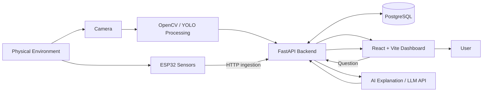

# SENTRA — High-Level Design (HLD)

**Project:** SENTRA — AI Environmental Intelligence and Activity Analysis
**Status:** Describes the known software implementation and separates pending capabilities.

## 1. Purpose

SENTRA is an indoor environmental monitoring and activity-analysis system designed to combine camera observations and sensor readings, retain events and readings, present information through a web dashboard, and support evidence-based explanations of recorded activity.

## 2. Problem Statement

Monitoring systems can collect video and sensor data but leave users to interpret separate streams manually. SENTRA aims to bring these sources together so activity can be observed, stored, reviewed, and explained in context.

## 3. Goals and Scope

### Current implementation
- React and Vite frontend.
- FastAPI backend using Python and Pydantic.
- SQLAlchemy database access with PostgreSQL configuration.
- Event and sensor-reading persistence.
- Camera service using OpenCV with YOLO detection integration.
- REST endpoints for health, camera, events, sensors, and AI operations.
- AI explanation endpoint structure with an external LLM API client.

### Pending or requiring validation
- Live physical ESP32 sensor acquisition.
- Physical validation of all sensors and the hardware-to-dashboard path.
- Successful live LLM generation when API quota/credits are available.
- Complete physical-room Digital Twin reconstruction and synchronization.
- Fully validated anomaly detection and activity prediction.
- MongoDB integration, if it remains a project requirement. The current event and sensor persistence described here uses PostgreSQL.

## 4. System Context

1. **Physical environment:** room, people, lighting, temperature, humidity, and other measurable conditions.
2. **Perception:** camera and, when available, ESP32-connected sensors.
3. **Backend and persistence:** FastAPI services, processing logic, and PostgreSQL.
4. **User interface and AI:** React dashboard and AI question-answering endpoint.

## 5. High-Level Architecture

The ESP32-to-backend path is intended for physical deployment. Synthetic HTTP payloads can test software ingestion but do not prove live hardware connectivity.

## 6. Major Components

### 6.1 Frontend
**Technology:** React, Vite, JavaScript, CSS.
**Responsibility:** display environment information, sensor readings, camera/activity views, event history, and AI interaction. It communicates with backend REST endpoints through the frontend API service.

### 6.2 Backend API
**Technology:** Python, FastAPI, Pydantic, SQLAlchemy.
**Responsibility:** expose REST endpoints, validate incoming payloads, coordinate camera and database services, and provide AI-related operations. Configuration and secrets are loaded from environment variables.

### 6.3 Camera and Perception
**Technology:** OpenCV and YOLO model integration.
**Responsibility:** acquire camera frames, expose camera status/stream, and provide detection output for activity/event workflows. Detection quality must be validated in the target environment.

### 6.4 Sensor Ingestion
**Intended device:** ESP32 with supported environmental/motion sensors.
**Responsibility:** validate incoming readings, map fields to registered sensor records, and persist readings. API tests using synthetic payloads are not proof of live ESP32 operation.

### 6.5 Database
**Technology:** PostgreSQL through SQLAlchemy.
**Known tables:** `events`, `rooms`, `sensors`, and `sensor_readings`.
**Responsibility:** retain event records, sensor metadata, and time-stamped sensor readings.

### 6.6 AI Explanation
**Responsibility:** accept user questions and prepare explanations using available event evidence. Live generation depends on valid credentials, network access, and provider quota. A configured client alone does not prove successful live generation.

## 7. Key Data Flows

### 7.1 Sensor flow
1. A physical device or test client produces a measurement.
2. The client sends a payload to the sensor-ingestion endpoint.
3. FastAPI validates the payload.
4. The backend maps supported fields to registered sensors.
5. SQLAlchemy stores readings in PostgreSQL.
6. The frontend requests latest readings and renders available values.

### 7.2 Camera and event flow
1. The camera service acquires frames.
2. The perception pipeline processes frames and may produce detections.
3. The backend creates or retrieves event records.
4. Events are stored in PostgreSQL.
5. The frontend retrieves and displays activity.

### 7.3 AI question flow
1. The user submits a question.
2. The frontend sends it to the AI endpoint.
3. The backend obtains relevant event evidence.
4. The AI service prepares a response when provider access is available.
5. The backend returns the response.

## 8. Interfaces

Known routes include:
- `GET /health`
- `GET /camera/status`
- `GET /camera/detections`
- `GET /camera/stream`
- `GET /events/`
- `POST /events/`
- `POST /sensors/ingest`
- `GET /sensors/latest`
- `GET /ai/health`
- `POST /ai/ask`

Exact contracts are defined by the current FastAPI routes and Pydantic models.

## 9. Deployment View

### Development
- Frontend runs through Vite.
- Backend runs through Uvicorn/FastAPI.
- PostgreSQL runs as a local database service.
- Credentials remain in ignored environment files.

### Hardware deployment
An ESP32 and sensors send readings to the backend over the network. Network reachability, device identity, calibration, and reconnection behaviour require physical validation.

## 10. Quality Attributes

- **Maintainability:** frontend, API, camera, and database responsibilities are separated.
- **Security:** secrets are loaded from environment variables and excluded from Git.
- **Reliability:** database transactions and API error responses support persistence operations.
- **Observability:** health/status endpoints and logs support diagnosis.
- **Extensibility:** sensor mappings and service modules allow new capabilities to be added.

## 11. Risks and Constraints

- Stored readings do not prove that a device is currently online.
- Physical sensor readings cannot be certified until hardware is connected.
- Camera performance depends on placement, lighting, and compute resources.
- LLM availability depends on credentials, quota, network, and provider status.
- Pending features must not be presented as completed.

## 12. Future Enhancements

- Complete room Digital Twin reconstruction with uncertainty labels.
- Synchronize detected people and objects with the room model.
- Validate behavioural analysis, anomaly detection, prediction, and historical retrieval.
- Add robust device heartbeat/last-seen tracking.
- Add automated integration tests and deployment monitoring.
