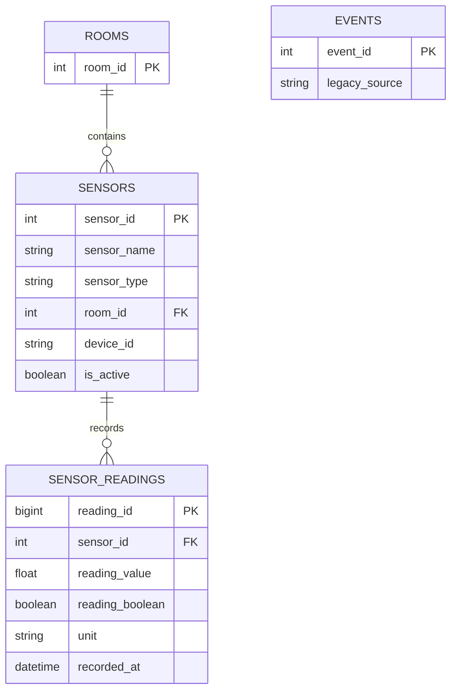

# SENTRA — Low-Level Design (LLD)

**Project:** SENTRA — AI Environmental Intelligence and Activity Analysis
**Status:** Describes known implementation details. Exact API contracts should be checked against source code.

## 1. Purpose

This document describes the internal modules, API boundaries, data model, and processing sequences used by SENTRA.

## 2. Technology Stack

| Layer | Technology |
|---|---|
| Frontend | React, Vite, JavaScript, CSS |
| Backend | Python, FastAPI, Uvicorn |
| Validation | Pydantic |
| ORM | SQLAlchemy |
| Relational database | PostgreSQL |
| Camera processing | OpenCV |
| Detection | YOLOv8 integration |
| AI integration | OpenAI API client |
| Version control | Git and GitHub |

## 3. Repository Structure

```text
SENTRA/
├── Frontend1/
│   └── src/
│       ├── components/
│       ├── services/
│       ├── App.jsx
│       └── App.css
├── backend/
│   ├── api/
│   │   ├── sensors.py
│   │   └── ...
│   ├── models/
│   │   ├── event.py
│   │   └── sensor.py
│   ├── scripts/
│   │   └── migrate_legacy_events.py
│   ├── database.py
│   └── main.py
└── .gitignore
```

## 4. Backend Module Design

### 4.1 Database configuration — `backend/database.py`
- Loads backend configuration from the backend environment file.
- Reads `DATABASE_URL`.
- Creates the SQLAlchemy engine.
- Applies SQLite-specific connection arguments only for SQLite URLs.
- Creates `SessionLocal` and declarative `Base`.
- Database credentials must remain outside source control.

### 4.2 Event model — `backend/models/event.py`
The Event model maps event records to the relational `events` table. It supports event and activity workflows. The current model includes a nullable `legacy_source` field for imported legacy records. The full schema is defined by the SQLAlchemy model.

### 4.3 Sensor models — `backend/models/sensor.py`

**Sensor**
- `sensor_id`: primary key.
- `sensor_name`: required name.
- `sensor_type`: required type used for mapping.
- `room_id`: nullable foreign key to `rooms.room_id`.
- `device_id`: optional device identifier.
- `is_active`: active/inactive flag.

**SensorReading**
- `reading_id`: primary key.
- `sensor_id`: required foreign key to `sensors.sensor_id`.
- `reading_value`: optional numeric value.
- `reading_boolean`: optional Boolean value.
- `unit`: optional unit label.
- `recorded_at`: timestamp with database-generated default.

One sensor can have many readings; each reading belongs to one sensor.

## 5. Database Relationships



The diagram shows known relationships and representative fields. The full event and room schemas are defined in their respective models.

## 6. Sensor API Design

### 6.1 `POST /sensors/ingest`

**Purpose:** accept sensor readings and persist values for registered active sensors.

**Processing sequence:**
1. Receive JSON request.
2. Validate the payload using the Pydantic input model.
3. Identify supported fields through the sensor mapping.
4. Find the matching active sensor for the device.
5. Create `SensorReading` records for supplied values.
6. Commit the transaction.
7. Update in-memory latest-value state only after successful persistence.
8. Return a success response.

**Error handling:**
- Invalid input may return HTTP 400 or framework validation errors.
- Database failures trigger rollback and a server error response.
- A failed transaction must not be treated as a successful write.

Synthetic JSON requests test the API/database path, not the physical ESP32 connection.

### 6.2 `GET /sensors/latest`

**Purpose:** return the latest stored reading for supported sensor types.

**Processing sequence:**
1. Open a database session.
2. Query registered sensors and their readings.
3. Select the latest available reading per supported type for the configured device.
4. Map database sensor types to response fields.
5. Return readings with timestamps and source metadata.
6. Close the session.

A PostgreSQL response indicates data was retrieved from the database; it does not independently prove that an ESP32 is currently connected.

### 6.3 Known sensor mapping

| API field | Purpose |
|---|---|
| `motion` | Motion state |
| `temperature` | Temperature |
| `humidity` | Relative humidity |
| `light` | Light level |
| `distance` | Distance |
| `sound_raw` | Raw sound sensor value |

Only fields explicitly mapped and persisted should be described as database-backed.

## 7. Event and Camera Modules

The event API creates and retrieves event records used by the dashboard and activity analysis.

The camera service uses OpenCV video capture and exposes camera status/stream functionality through the camera router. YOLO-based detection is integrated as the detection component. Detection output can be used by event-processing logic.

Frame rate, confidence thresholds, tracking configuration, and event-deduplication rules must be taken from the current camera source/configuration; they are not specified here.

## 8. AI API Design

The AI module provides:
- An AI health/status route.
- An AI question endpoint.
- Evidence-oriented instructions/prompts.
- An external LLM API client configured through environment variables.

A health response indicates configuration/readiness; it does not guarantee a live model request will succeed. Live generation requires valid credentials, network access, and provider quota.

## 9. Frontend Module Design

### 9.1 Application composition
`App.jsx` composes the dashboard and feature components. Known components include `LiveEnvironment`, `DigitalTwin`, `CompactSensors`, `Sensors`, `ActivityChart`, and event/zone-related components.

### 9.2 API service
`Frontend1/src/services/api.js` centralizes frontend HTTP calls to backend endpoints.

### 9.3 Sensor components
- `CompactSensors.jsx` provides a compact sensor overview.
- `Sensors.jsx` provides the fuller sensor view.
- Their CSS files control presentation and responsive layout.

The frontend should distinguish stored readings, stale readings, API failures, and confirmed live device connectivity. A database response alone is not proof of a live ESP32 connection.

## 10. Configuration and Secrets

- Backend database URL and LLM credentials are read from environment variables.
- Frontend configuration uses Vite environment variables.
- `.env`, local databases, backups, virtual environments, and build artefacts are excluded through `.gitignore`.
- Never commit API keys, passwords, or private database credentials.

## 11. Test Strategy

### Backend
- Health endpoint returns expected status.
- Valid event creation and retrieval.
- Valid sensor payload is accepted and persisted.
- Latest readings are retrieved from PostgreSQL.
- Invalid sensor payload is rejected.
- Database exceptions cause rollback and an error response.
- AI endpoint handles unavailable provider credentials/quota safely.

### Frontend
- Vite production build completes.
- Dashboard components render.
- API loading, success, empty, and error states are handled.
- Sensor values and timestamps display correctly.
- Stored data is not incorrectly labelled as a live device connection.

### Integration
- Frontend reaches backend.
- Backend connects to PostgreSQL.
- Sensor ingestion appears in latest-reading endpoint.
- Event records are visible in dashboard.
- Camera stream and detection workflows are tested with camera available.

### Hardware
- Verify ESP32 network connection.
- Verify each physical sensor independently.
- Verify transmission to backend.
- Verify timestamps/readings in PostgreSQL.
- Verify dashboard updates from actual device readings.

Hardware tests remain pending until physical hardware is available.

## 12. Known Limitations

- The latest-reading endpoint has used a configured device identifier; multi-device selection should become configurable.
- Optional fields may be accepted but not persisted unless explicitly included in the sensor mapping.
- In-memory latest-value state is not a substitute for durable history.
- Live LLM output depends on provider quota and credentials.
- Physical sensor and camera behaviour requires target-environment testing.
