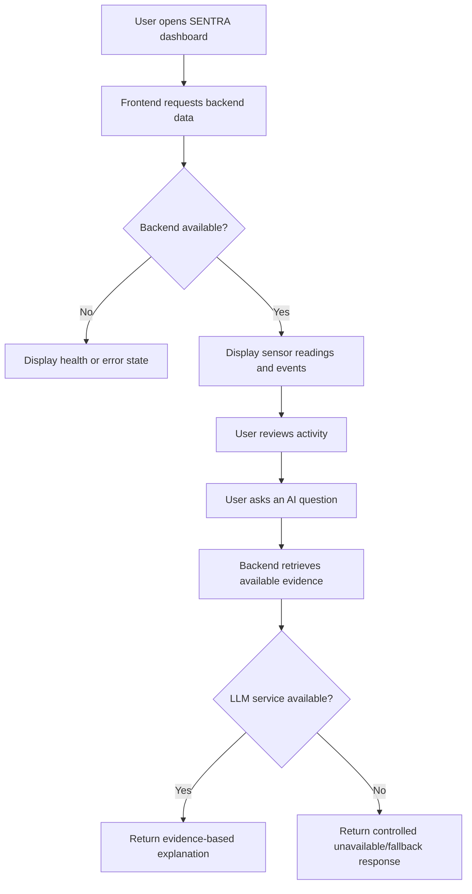

# SENTRA — Product Requirements Document (PRD)

**Project:** SENTRA — AI Environmental Intelligence and Activity Analysis
**Status:** Separates current implementation from planned capabilities.

## 1. Product Overview

SENTRA is an indoor environmental intelligence and activity-monitoring project. It is intended to combine camera observations and sensor measurements, retain activity history, present information through a web dashboard, and help users understand recorded activity through evidence-based AI explanations.

## 2. Problem Statement

Monitoring systems may collect video and sensor readings without presenting a unified view of what is happening. Users may need to inspect separate sources and manually correlate events.

SENTRA addresses this by bringing camera-derived events and sensor readings into a common backend and dashboard, with historical storage and an AI-assisted explanation interface.

## 3. Product Vision

The intended workflow is:

**Observe → Understand → Remember → Learn → Detect → Predict → Explain**

This is the product direction. Each capability must be validated before being described as production-complete.

## 4. Target Users

- A user monitoring an indoor room or controlled environment.
- A project evaluator reviewing environmental monitoring and activity workflows.
- A developer or administrator configuring devices and reviewing system health.

## 5. Primary Use Cases

1. View the dashboard.
2. Review available sensor readings.
3. View camera status and camera-derived activity.
4. Review historical events.
5. Ask a question about recorded activity.
6. Diagnose unavailable devices or backend services.

## 6. Product Goals

- Combine environmental readings and camera-related activity in one application.
- Persist sensor readings and events for historical review.
- Provide a clear dashboard for current and historical information.
- Provide an evidence-based AI explanation workflow.
- Keep the system modular so additional sensors and intelligence features can be added.

## 7. Functional Requirements

| ID | Requirement | Status |
|---|---|---|
| FR-01 | The system shall expose a backend health endpoint. | Implemented |
| FR-02 | The system shall expose camera status/stream functionality. | Implemented; physical validation required |
| FR-03 | The system shall accept validated sensor-ingestion requests. | Implemented; API tested with synthetic payloads |
| FR-04 | The system shall persist supported sensor readings in PostgreSQL. | Implemented; API/database path tested |
| FR-05 | The system shall return latest stored sensor readings. | Implemented |
| FR-06 | The system shall create and retrieve event records. | Implemented |
| FR-07 | The frontend shall present sensor information. | Implemented; UI validation required |
| FR-08 | The frontend shall present event/activity information. | Implemented; end-to-end validation required |
| FR-09 | The system shall provide an AI question endpoint. | Implemented; live generation depends on provider access |
| FR-10 | AI explanations shall use available event evidence. | Prompt/workflow implemented; quality requires validation |
| FR-11 | The system shall receive physical ESP32 readings. | Pending hardware validation |
| FR-12 | The system shall reconstruct and synchronize a physical-room Digital Twin. | Planned / pending |
| FR-13 | The system shall detect and predict anomalous behaviour. | Planned / pending validation |
| FR-14 | The system shall provide historical activity retrieval and explanation. | Partially implemented; end-to-end validation required |

## 8. Non-Functional Requirements

### Reliability
- Database writes should use transactions.
- Failed writes should be rolled back.
- API failures should return meaningful HTTP error responses.
- The frontend should show loading, empty, and error states.

### Security
- Secrets must be stored in environment variables.
- Credentials must not be committed to Git.
- API inputs must be validated.
- Database access must use controlled backend sessions.

### Maintainability
- Keep frontend, API, database, camera, and AI responsibilities separated.
- Use clear model and endpoint naming.
- Keep documentation aligned with actual code.

### Performance
- Avoid unnecessary dashboard data fetching.
- Monitor camera processing and model inference resource usage.
- Consider code splitting for large frontend assets.

### Usability
- Present sensor values with readable labels and units.
- Distinguish live device connectivity from previously stored readings.
- Make errors and unavailable services understandable.

## 9. User Workflow

## 10. Acceptance Criteria

### Dashboard and API
- Backend health endpoint responds when backend is running.
- Dashboard retrieves available event and sensor data.
- API errors do not crash the frontend.
- Missing sensor values are displayed as unavailable rather than fabricated.

### Sensor persistence
- A valid test payload is accepted.
- Supported values are stored against registered sensors.
- Latest-reading endpoint returns persisted values.
- Invalid input is rejected with an appropriate response.
- Database failure does not report a successful write.

### Event history
- A valid event can be created.
- Created events can be retrieved.
- Event history is displayed in the dashboard.

### AI explanation
- The question endpoint accepts a valid question.
- The response uses available event evidence.
- Provider unavailability is handled without claiming successful live generation.

### Hardware
- A physical ESP32 sends a reading to the backend.
- The reading is persisted and returned by the latest-reading endpoint.
- The dashboard displays the actual device reading.
- Device disconnection is distinguishable from old stored readings.

### Documentation and delivery
- HLD, LLD, and PRD exist at repository root.
- Documentation matches implemented architecture.
- Secrets and local database backups are not committed.
- Changes are committed and pushed to the original GitHub repository.

## 11. Out of Scope for the Current Verified Build

Do not represent the following as complete without further implementation and tests:
- Fully validated live ESP32 hardware operation.
- Complete room geometry reconstruction.
- Fully synchronized real-time Digital Twin.
- Production-grade anomaly prediction.
- Guaranteed live LLM generation when provider quota is unavailable.
- MongoDB functionality unless separately integrated and tested.

## 12. Risks and Dependencies

- Physical hardware is required for sensor validation.
- Network connectivity is required for device-to-backend communication.
- LLM provider credentials and quota are required for live generation.
- Camera quality, lighting, and placement affect detection.
- Kalvium's exact validation criteria may require additional sections or formatting.

## 13. Future Roadmap

1. Complete software integration and automated tests.
2. Validate camera-to-event-to-dashboard workflow.
3. Validate physical sensor ingestion with ESP32.
4. Complete Digital Twin reconstruction and synchronization.
5. Validate behavioural analysis, anomaly detection, and prediction.
6. Improve AI retrieval and explanation quality.
7. Add monitoring, deployment documentation, and performance optimisation.
